# Capturas para el video — DRFC Ingeniería

**Fecha:** 10 de noviembre de 2026
**Sitio:** [www.drfc.mx](https://www.drfc.mx/) (versión publicada)
**Formato:**
- Escritorio: ventana de 1440 × 900 px a densidad 2× (archivos de 2880 px de ancho).
- Móvil: 390 × 844 px a 3× (1170 × 2532 px, tamaño de iPhone).
- Video: MP4 de 1920 × 1080 a 30 fps.

En las capturas de sección, el menú fijo se quitó para que no tape la parte de arriba de cada bloque. Los contadores animados y las animaciones de entrada se capturaron ya terminados.

---

## 1. Gancho

Hero de la página de inicio en su primera diapositiva, con el titular "Soluciones integrales en telecomunicaciones", el menú y el logotipo.

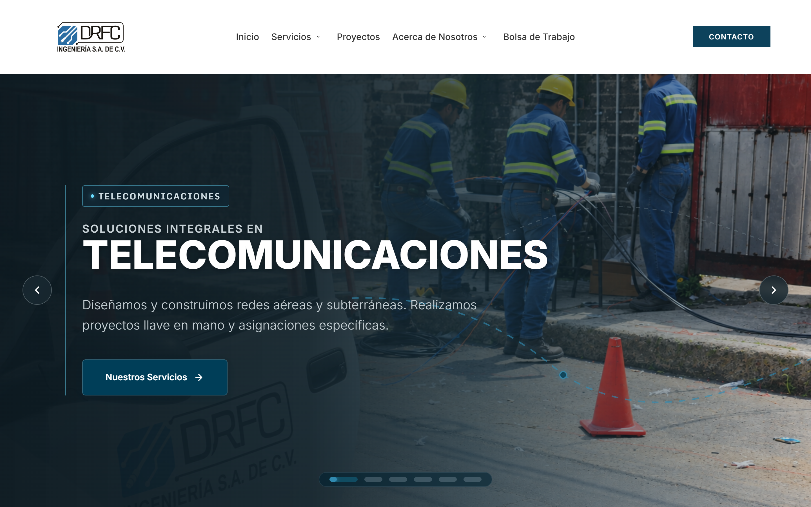

## 2. Por qué existe

Cuatro tomas consecutivas de la página de inicio, una por bloque, bajando desde el hero.

| Archivo | Bloque |
|---|---|
| `02_porque_inicio-bloque-a_v1.png` | Nuestra experiencia a tu servicio |
| `02_porque_inicio-bloque-b_v1.png` | Nuestros clientes principales |
| `02_porque_inicio-bloque-c_v1.png` | Todas las etapas de tu red, bajo un mismo equipo |
| `02_porque_inicio-bloque-d_v1.png` | Cobertura nacional |

Los bloques A y B son las mismas secciones que se usan en las escenas 4 y 3. Para que el video no repita imágenes, los bloques C y D sirven solos para esta escena.

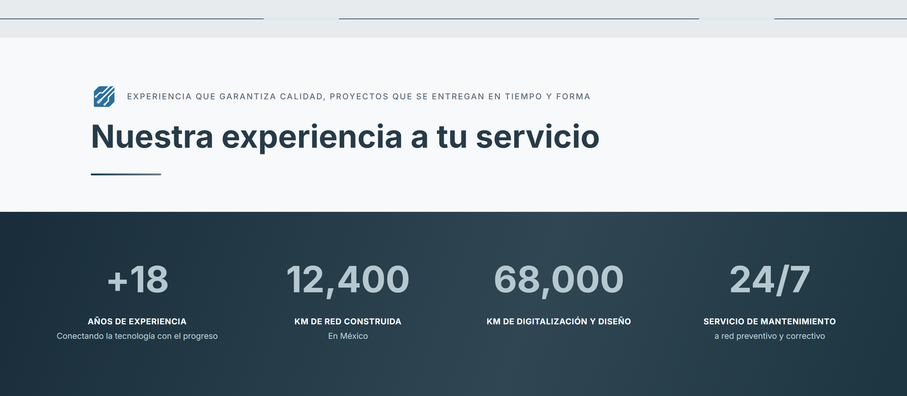
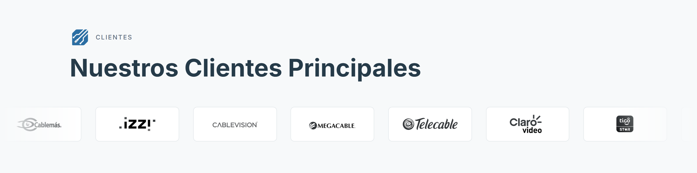
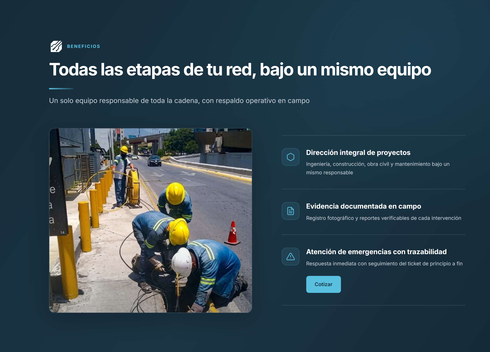
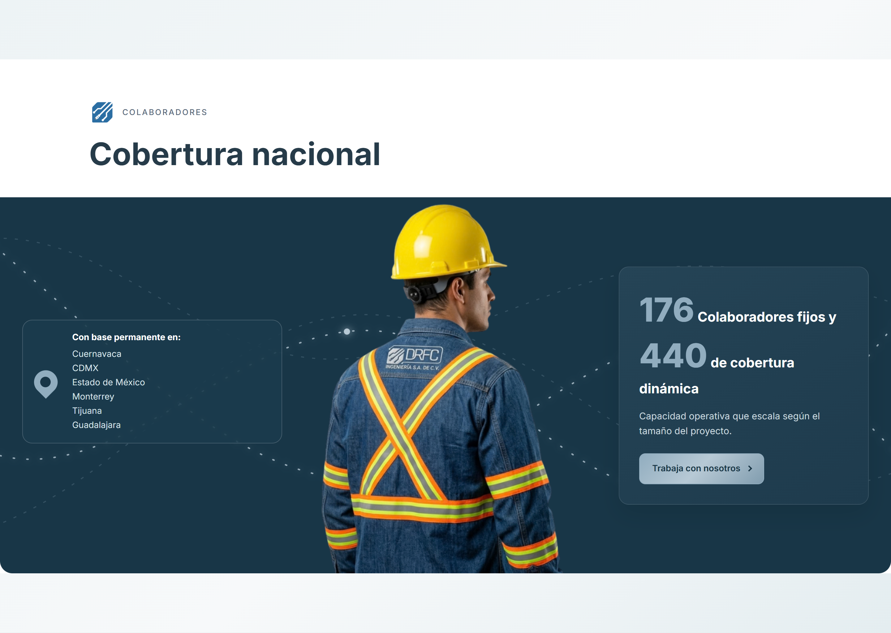

## 3. A quién le hablamos

- **`03_publico_logos-clientes_v1.mp4`**: grabación de 6.8 s, 1920 × 1080, con el carrusel de logos en movimiento. Se hizo a 1920 px de ancho para que se vean más logos a la vez (unos 7 completos).
- **`03_publico_logos-clientes_v1.png`**: foto fija de la sección, por si se prefiere una imagen.

El carrusel avanza despacio (una vuelta completa tarda 30 s), así que en la grabación se desplazan unos dos logos.

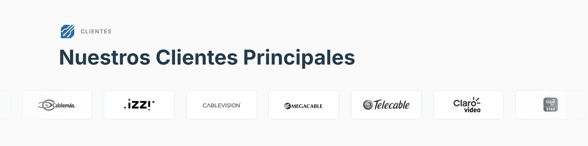

## 4. Cifras

Franja "Nuestra experiencia a tu servicio" con las 4 cifras ya completas: **+18 años, 12,400 km, 68,000 km, 24/7**.

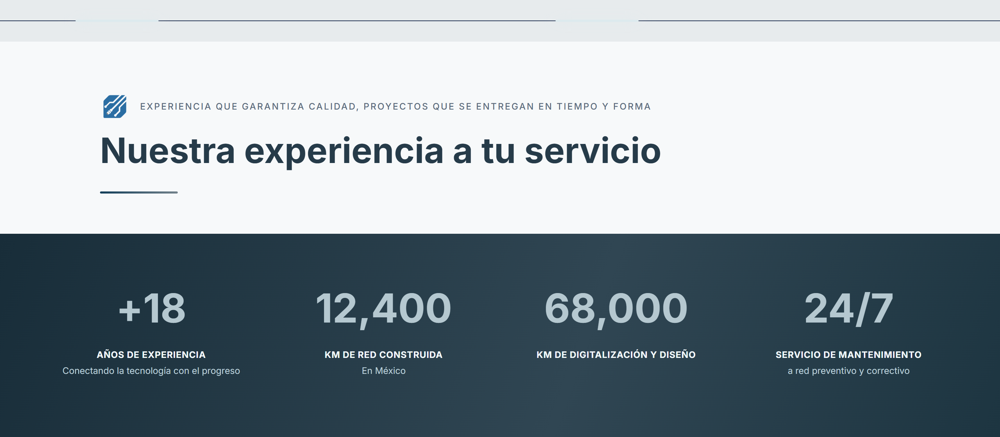

## 5. Servicios

**a) Cuadrícula de las cinco categorías.** Página de Servicios, sección "Nuestros servicios".

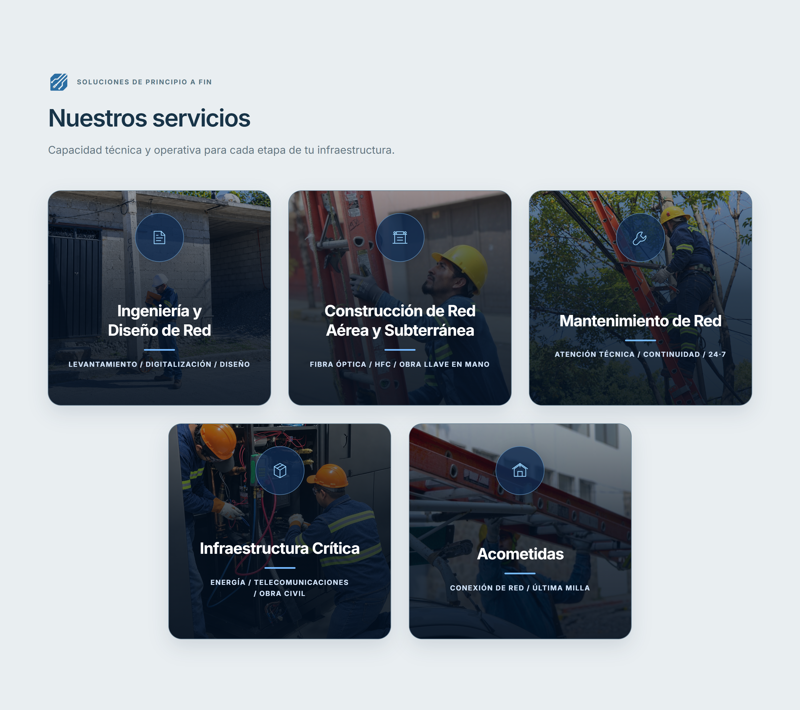

**b) Pestañas.** La página de Servicios publicada **no tiene pestañas**: cada tarjeta de la cuadrícula lleva a su propia página. En su lugar, se capturó la primera vista de la página de cada una de las cuatro áreas:

| Archivo | Página |
|---|---|
| `05_servicios_pestana-ingenieria_v1.png` | Ingeniería y diseño de red |
| `05_servicios_pestana-construccion_v1.png` | Construcción de red aérea y subterránea |
| `05_servicios_pestana-mantenimiento_v1.png` | Mantenimiento a la red activa |
| `05_servicios_pestana-obra-civil_v1.png` | Infraestructura crítica (obra civil) |

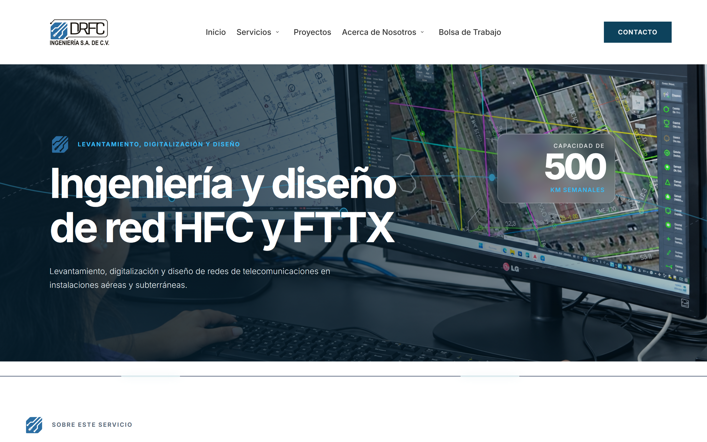
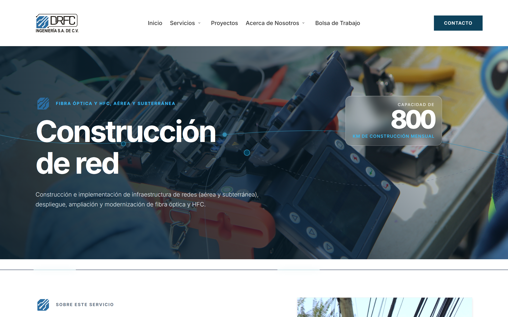
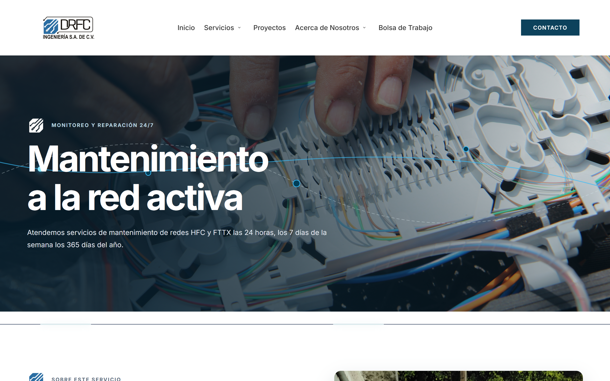
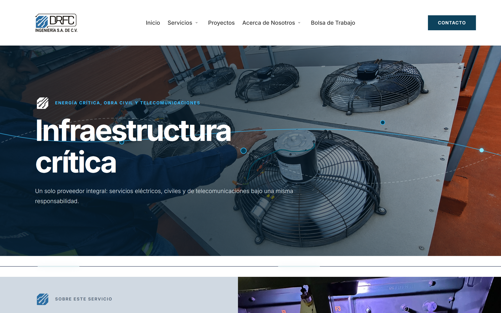

**c) Llave en mano.** No hay una sección propia con ese nombre. El texto más cercano está en el bloque "El reto / Nuestra solución" de la página de Servicios: *"Diseñamos y construimos redes aéreas y subterráneas con proyectos llave en mano…"*. La frase "llave en mano" también aparece en la tarjeta de Construcción de la cuadrícula y en el hero de inicio.

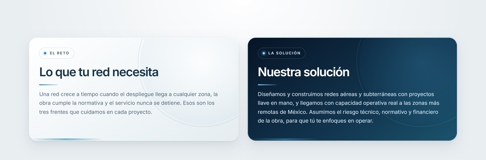

## 6. Navegación

**a) Menú desplegado.** Submenú de Servicios abierto.

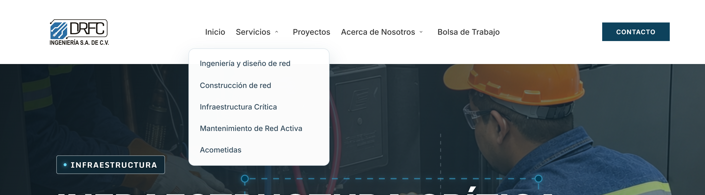

**b) Página de un área.** Infraestructura y obra civil, desde el encabezado hasta la sección "Gestión integral de infraestructura".

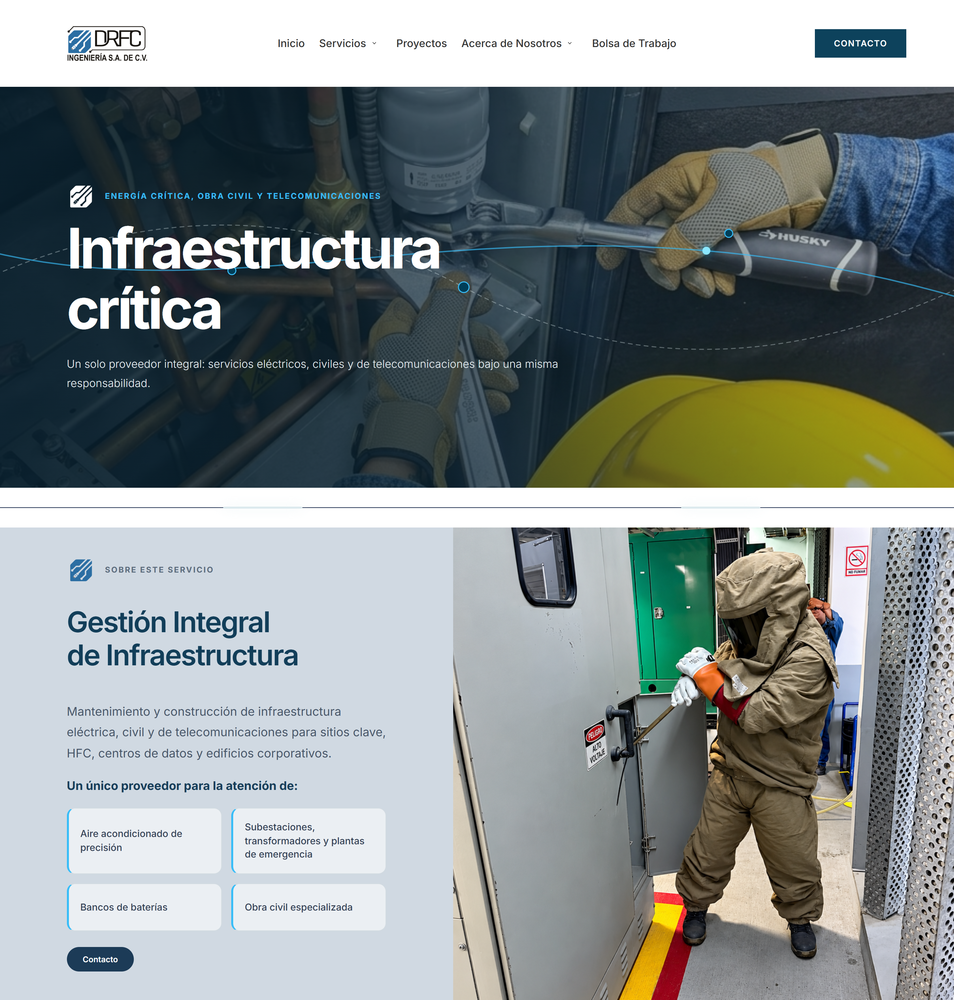

**c) Vista móvil.** Inicio (primera diapositiva) y Servicios, en modo móvil del navegador.

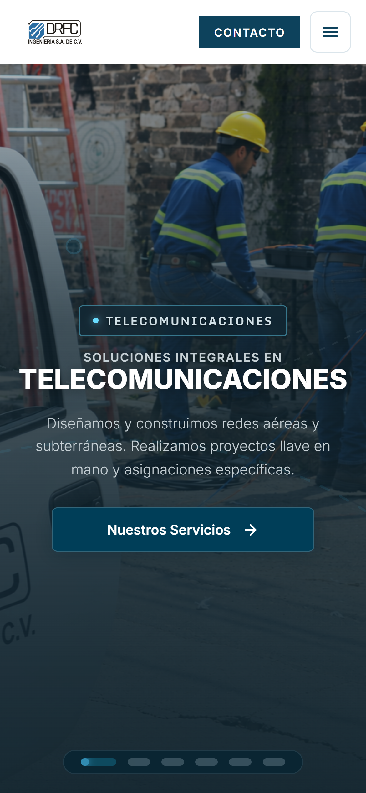
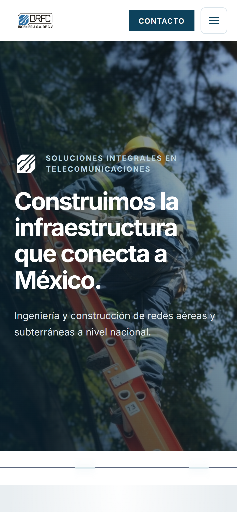

## 7. Cierre

Banner "Agendemos una reunión técnica para evaluar tu próximo despliegue" y pie de página completo.

En el pie aparece solo el ícono de DRFC, no el logotipo con texto. Si el cierre necesita el logotipo completo, se puede usar el del encabezado (escena 1).

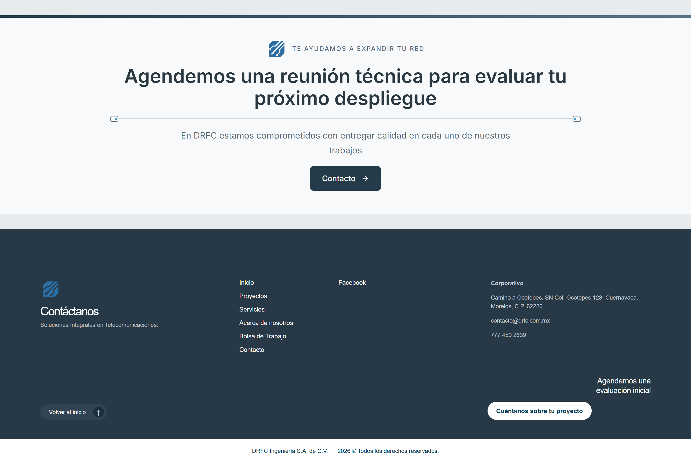

---

## Video armado

| Archivo | Duración | Contenido |
|---|---|---|
| `DRFC_video_sitio_v1.mp4` | 1:18.9 | Video completo, sin audio. Empieza con los últimos 10 s de la cuenta regresiva |
| `00_inauguracion_cuenta-regresiva-60s_v1.mp4` | 1:01.0 | Cuenta regresiva completa, de 1:00 a 0:00, más 1 s en 0:00. Sirve para reemplazar el arranque si se quiere la cuenta entera |

Formato de ambos: MP4 H.264 de 1920 × 1080 a 30 fps. Entre tomas hay un fundido de 0.6 s, así que cada toma empieza 0.6 s antes de que termine la anterior.

### Escaleta para la narración y la música

| Tiempo | Escena | Toma |
|---|---|---|
| 0:00 – 0:11 | Inauguración | Cuenta regresiva 0:10 → 0:00, con 1 s quieto en 0:00 |
| 0:10 – 0:15 | 1. Gancho | Hero "Soluciones integrales en telecomunicaciones" (acercamiento lento) |
| 0:15 – 0:20 | 2. Por qué existe | Todas las etapas de tu red (recorrido hacia abajo) |
| 0:19 – 0:24 | 2. Por qué existe | Cobertura nacional (recorrido hacia abajo) |
| 0:24 – 0:31 | 3. A quién le hablamos | Carrusel de logos de clientes en movimiento |
| 0:30 – 0:35 | 4. Cifras | +18 años, 12,400 km, 68,000 km, 24/7 |
| 0:34 – 0:40 | 5a. Servicios | Cuadrícula de las cinco categorías (recorrido hacia abajo) |
| 0:40 – 0:43 | 5b. Servicios | Ingeniería y diseño de red |
| 0:43 – 0:46 | 5b. Servicios | Construcción de red |
| 0:46 – 0:49 | 5b. Servicios | Mantenimiento a la red activa |
| 0:49 – 0:52 | 5b. Servicios | Infraestructura crítica (obra civil) |
| 0:51 – 0:56 | 5c. Servicios | Llave en mano ("Nuestra solución") |
| 0:55 – 0:59 | 6a. Navegación | Menú desplegado (acercamiento al submenú) |
| 0:59 – 1:05 | 6b. Navegación | Página de Infraestructura (recorrido hacia abajo) |
| 1:04 – 1:10 | 6c. Navegación | Vista móvil: inicio y servicios |
| 1:10 – 1:16 | 7. Cierre | Banner de contacto y pie de página |
| 1:15 – 1:19 | 7. Cierre | Logotipo DRFC, www.drfc.mx |

Si la narración queda más larga o más corta, se puede ajustar la duración de cada toma y volver a generar el video.

---

## Diferencias con el guion

| Escena | Pedido | Entregado |
|---|---|---|
| 5b | 4 pestañas en Servicios | El sitio no tiene pestañas; se usaron las 4 páginas de área |
| 5c | Sección llave en mano | No hay sección propia; se usó el bloque "Nuestra solución" |
| 7 | Pie con logotipo | El pie muestra solo el ícono |
