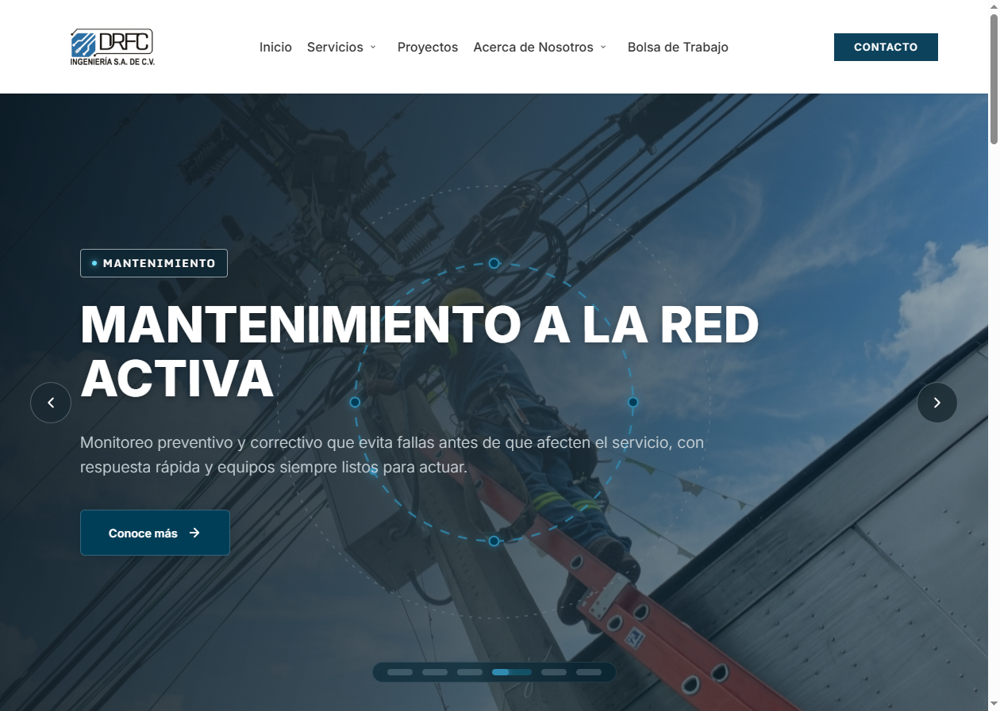
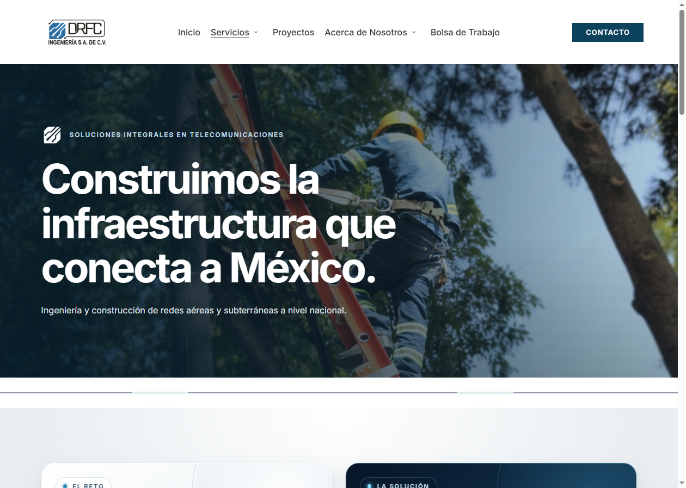
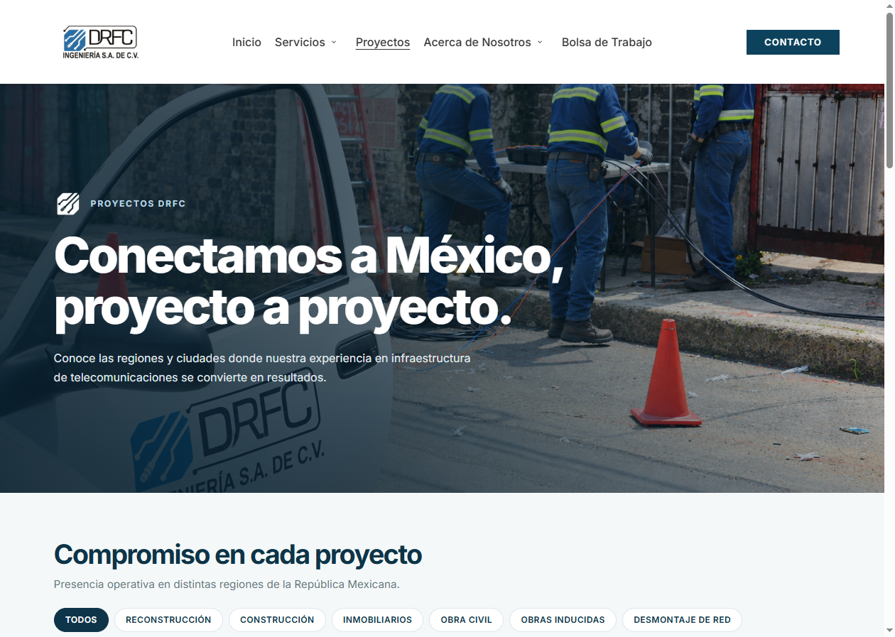
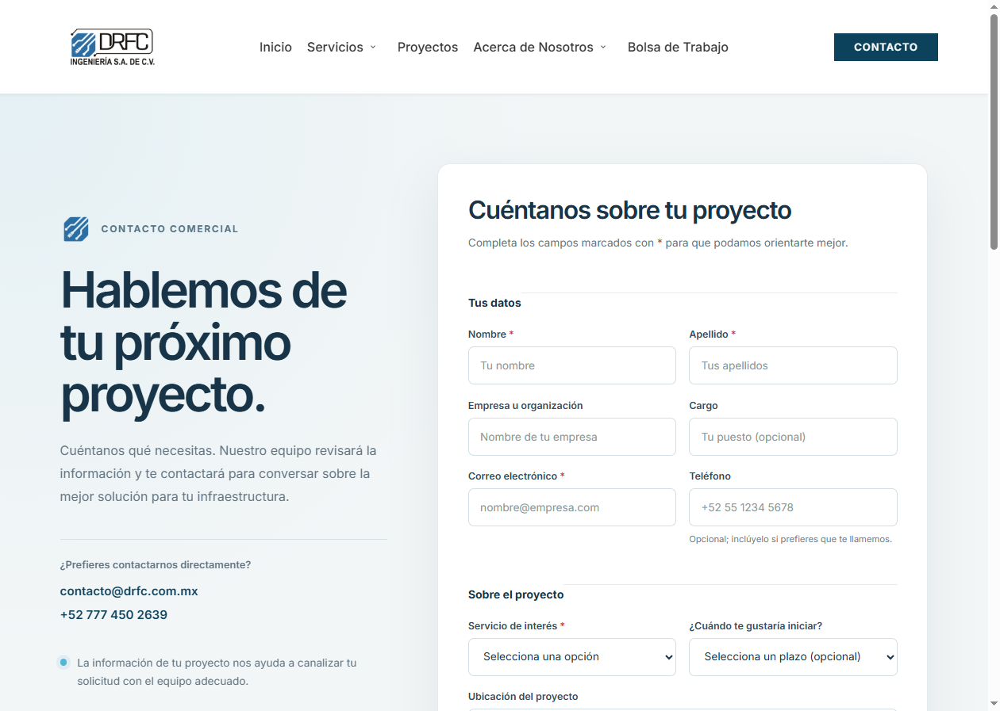

# Reporte de revisión visual — DRFC Ingeniería

**Fecha de revisión:** 10 de noviembre de 2026  
**Sitio revisado:** [www.drfc.mx](https://www.drfc.mx/)  
**Cobertura:** Inicio, Servicios, Proyectos y Contacto. Las capturas muestran la primera vista de cada página en escritorio.

## Resumen ejecutivo

El sitio presenta una identidad visual consistente y comunica con claridad los servicios de ingeniería y construcción de redes. La navegación principal permite llegar a las áreas clave y la página de contacto ofrece un formulario detallado junto con medios de contacto directos.

Durante la revisión, el navegador mostró una advertencia en la página de contacto: el formulario apunta a una dirección `mailto:` desde una página HTTPS. Conviene verificar ese flujo y confirmar cómo se informa al usuario si el envío se completa o falla.

## Capturas de pantalla

### Inicio

La portada usa una imagen de trabajo en campo, un mensaje principal sobre telecomunicaciones y navegación hacia los servicios. El carrusel puede mostrar una diapositiva distinta en cada visita.

### Servicios

La página abre con una propuesta sobre infraestructura de telecomunicaciones. En la primera vista capturada no se aprecia un botón de acción directo dentro del hero.

### Proyectos

El encabezado introduce los proyectos y permite filtrar por categorías, como reconstrucción, construcción y obra civil.

### Contacto

La composición combina un mensaje de contacto, teléfono y correo directo con un formulario que recopila datos del proyecto.

## Hallazgos y recomendaciones

| Prioridad | Hallazgo | Recomendación |
|---|---|---|
| Alta | El navegador reportó que el formulario de contacto apunta a `mailto:contacto@drfc.com.mx` desde una página HTTPS. No se comprobó el envío del formulario. | Verificar el mecanismo de entrega. Si se mantiene `mailto:`, considerar presentarlo como enlace explícito; de lo contrario, usar un destino HTTPS y mostrar confirmación o error después del envío. |
| Media | En la captura inicial de Servicios no se observa una acción primaria en el hero. | Evaluar agregar un botón visible —por ejemplo, para solicitar una evaluación o contactar al equipo— y medir si mejora el acceso a la conversión. |
| Media | Las capturas solo cubren escritorio y la primera vista de cada página. | Revisar en móvil y teclado la navegación, el carrusel, los filtros de proyectos y los campos del formulario. |

## Alcance y limitaciones

La revisión fue visual y puntual, sobre las páginas públicas indicadas. No incluye pruebas de envío del formulario, funcionamiento completo de filtros o enlaces, accesibilidad formal, rendimiento, SEO ni validación en distintos dispositivos. Las capturas corresponden al estado observado el día de la revisión.
